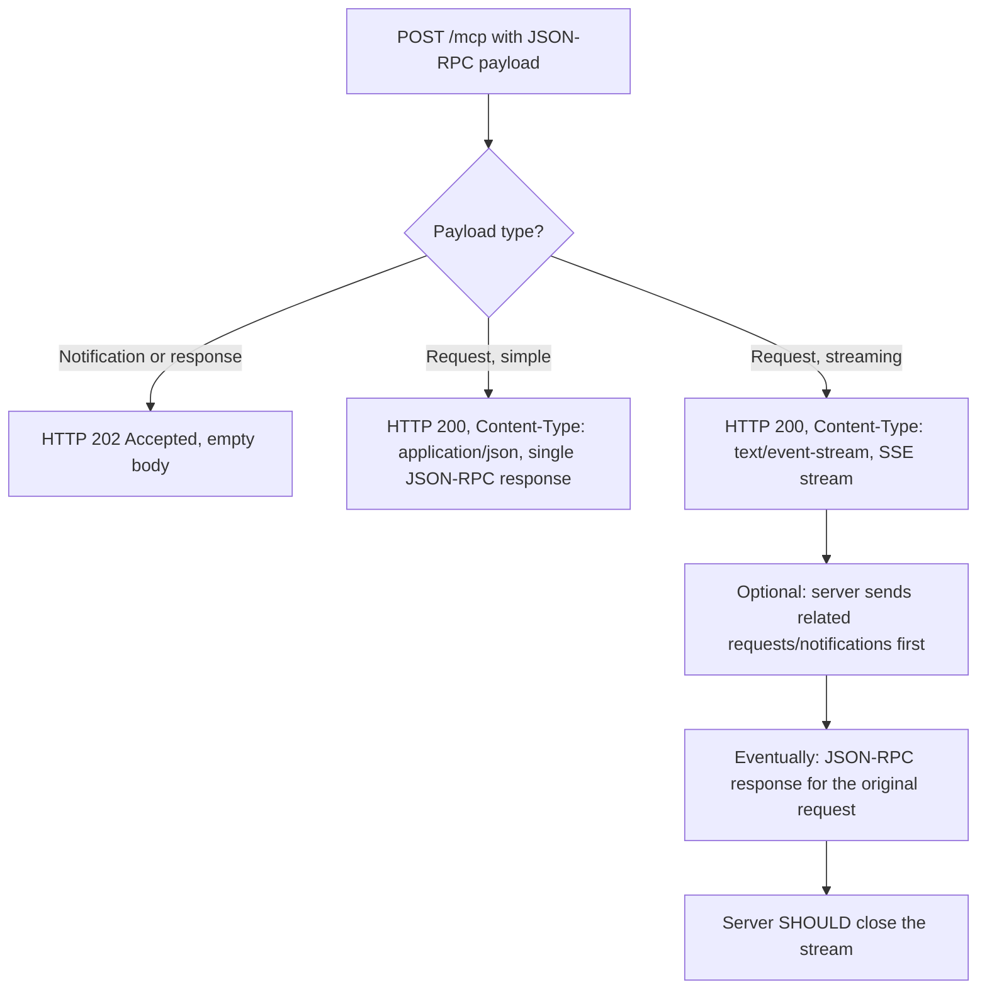
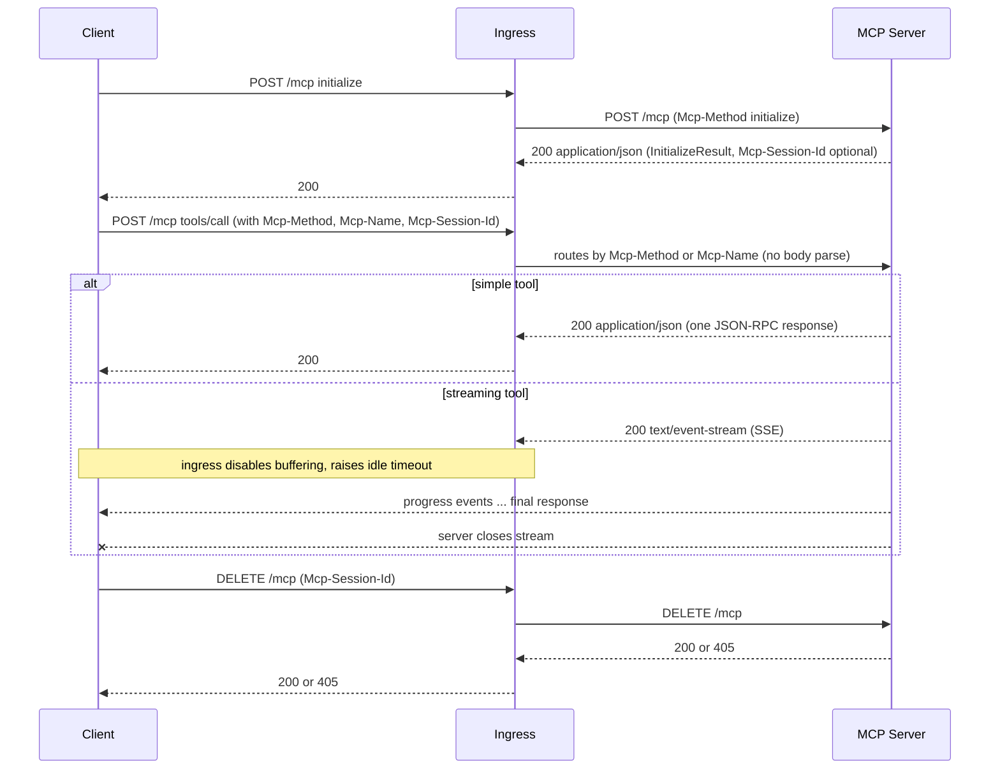

# 02. Transport architecture

This chapter explains exactly what happens on the wire between an MCP client and a streamable HTTP MCP server. If you are deploying or operating an MCP, you need to understand this so you can pick the right ingress, timeout, and session settings.

> **Source of truth**: [`sources/pages/spec-transports.md`](../sources/pages/spec-transports.md) and [`sources/pages/spec-sep-2243.md`](../sources/pages/spec-sep-2243.md). When in doubt, the spec wins. [src: spec-transports, spec-sep-2243]

## The MCP endpoint

A streamable HTTP MCP server **MUST** expose a single HTTP endpoint path (the "MCP endpoint") that supports both `POST` and `GET`. By convention this is `/mcp`, but any path is valid as long as it is documented to clients. [src: spec-transports]

```
POST  https://mcp.example.com/mcp     (client -> server messages)
GET   https://mcp.example.com/mcp     (optional server-initiated SSE stream)
DELETE https://mcp.example.com/mcp    (optional explicit session termination)
```

There is no separate "control" endpoint, no health endpoint defined by the spec, and no SSE-specific endpoint. Health checks (`/healthz`, `/readyz`) are an operational concern your service can add freely; the spec does not reserve those paths.

## Required HTTP headers

| Header | Direction | Purpose |
|---|---|---|
| `Accept: application/json, text/event-stream` | Client -> server | Client must accept both content types on POST. [src: spec-transports] |
| `Content-Type: application/json` | Client POST body | JSON-RPC payload. [src: spec-transports] |
| `Content-Type: application/json` or `text/event-stream` | Server response | The server picks per-request. [src: spec-transports] |
| `MCP-Protocol-Version: 2025-06-18` | Client -> server | Required after initialization. Servers reject unknown versions with 400. [src: spec-transports] |
| `Mcp-Session-Id: <id>` | Both | Required only if the server assigned a session at init. [src: spec-transports] |
| `Mcp-Method: <method>` | Client -> server (POST) | SEP-2243: mirrors JSON-RPC `method` for L7 routing. [src: spec-sep-2243] |
| `Mcp-Name: <name-or-uri>` | Client -> server (POST) | SEP-2243: mirrors `params.name` (tool/prompt) or `params.uri` (resource). Required for `tools/call`, `resources/read`, `prompts/get`. [src: spec-sep-2243] |
| `Last-Event-ID: <id>` | Client -> server (GET) | Used to resume a broken SSE stream. [src: spec-transports] |
| `Origin: <origin>` | Client -> server | Server **MUST** validate. Defends against DNS rebinding. [src: spec-transports] |

**Header / body consistency**: SEP-2243 requires servers to **reject** any request where `Mcp-Method` or `Mcp-Name` disagrees with the JSON body. This prevents a class of vulnerabilities where a load balancer routes by header but the server executes by body. [src: spec-sep-2243]

## Three response shapes

When the server receives a POST, the JSON-RPC payload type determines what the server does:



Key consequences for hosting: [src: spec-transports]

- **JSON responses** behave like any normal HTTP/1.1 or HTTP/2 request. Standard timeouts apply.
- **SSE responses** are long-lived. Your ingress, service mesh, and any intermediate proxy must:
  - **not buffer** the response (SSE is incremental),
  - allow **long idle timeouts** (minutes, not seconds),
  - keep the connection open across keep-alive boundaries,
  - and not coalesce or transform `text/event-stream` bodies.
- **Notifications and responses from the client** are acknowledged with a bare `202 Accepted`. They never produce an SSE stream.

The handbook's reference [nginx ingress config](../examples/nginx/streamable-mcp.conf) sets these correctly out of the box.

## Server-initiated streams via GET

A client **MAY** open an SSE stream by issuing `GET /mcp` with `Accept: text/event-stream`. The server then has two choices: [src: spec-transports]

- Return `Content-Type: text/event-stream` and start an SSE stream for server-initiated requests/notifications, or
- Return `405 Method Not Allowed` if the server does not offer this feature.

Servers that don't need to push asynchronous notifications to clients should simply respond with 405. This is the simplest and most ingress-friendly mode.

## Resumability and `Last-Event-ID`

If the server sets an `id:` field on its SSE events, a disconnected client can reconnect with `GET /mcp` carrying `Last-Event-ID: <last-id-it-saw>` and the server **MAY** replay missed events. [src: spec-transports]

Two operational implications:

- Event IDs must be **globally unique within a session** (or within a client, if no session is in use). [src: spec-transports]
- Replay requires the server to remember per-stream history. This is **incompatible with naive load balancing**: a different replica won't have the buffer. Either pin replays to the original replica via sticky session, or store the buffer in shared storage (Redis), or simply do not advertise resumability and let clients re-issue requests on disconnect. The trade-offs live in [05 Sessions and state](05-sessions-and-state.md).

## Session management

A streamable HTTP server **MAY** assign a session ID at initialization time by returning an `Mcp-Session-Id` header on the `InitializeResult` response. [src: spec-transports]

Rules:

- The ID **SHOULD** be globally unique and cryptographically secure (UUID, JWT, hash). [src: spec-transports]
- The ID **MUST** contain only visible ASCII (`0x21`..`0x7E`). [src: spec-transports]
- Once issued, the client **MUST** include `Mcp-Session-Id` on every subsequent request. [src: spec-transports]
- A request without a session ID (other than `initialize`) **SHOULD** be rejected with `400`. [src: spec-transports]
- The server **MAY** terminate a session at any time; subsequent requests with that ID get `404`. [src: spec-transports]
- A `404` tells the client to re-initialize without a session ID. [src: spec-transports]
- The client **SHOULD** send `DELETE /mcp` with the `Mcp-Session-Id` header when it's done with a session. The server **MAY** answer `405` if it disallows client-initiated termination. [src: spec-transports]

Sessions are **optional**. A stateless server simply does not return `Mcp-Session-Id` and ignores the header on subsequent requests. Stateless mode is the recommended default for horizontal scaling; stateful sessions are an opt-in for use cases that need them. The decision tree is in [05 Sessions and state](05-sessions-and-state.md).

## Protocol version negotiation

After the JSON-RPC `initialize` handshake, the client **MUST** include `MCP-Protocol-Version: <version>` on all subsequent HTTP requests. [src: spec-transports, spec-lifecycle]

Server behavior:

- A request with **no** `MCP-Protocol-Version` header (and no other way to derive the version) is treated as protocol `2025-03-26` for backwards compatibility. [src: spec-transports]
- A request with an **unsupported** version **MUST** be rejected with `400 Bad Request`. [src: spec-transports]

Practical consequence: if you're running multiple MCP server versions behind one ingress, the protocol version header is the cheapest way to route between them.

## SEP-2243 routing headers in detail

SEP-2243 was published as Final on 2026-02-04 and standardizes two headers that mirror JSON-RPC fields into HTTP headers: [src: spec-sep-2243]

```
POST /mcp HTTP/1.1
Host: mcp.example.com
Content-Type: application/json
Accept: application/json, text/event-stream
MCP-Protocol-Version: 2025-06-18
Mcp-Method: tools/call
Mcp-Name: get_weather

{"jsonrpc":"2.0","id":1,"method":"tools/call","params":{"name":"get_weather","arguments":{"city":"NYC"}}}
```

Required values: [src: spec-sep-2243]

| Header | Source field | Required for |
|---|---|---|
| `Mcp-Method` | JSON-RPC `method` | All requests and notifications |
| `Mcp-Name` | `params.name` or `params.uri` | `tools/call`, `resources/read`, `prompts/get` |

Why this matters for hosting:

- **Ingress routing**: an ingress can route `Mcp-Method=tools/call` and `Mcp-Name=billing.*` to a separate backend without touching the JSON body. [src: spec-sep-2243]
- **Rate limiting**: per-tool quotas can be enforced at the gateway. [src: spec-sep-2243]
- **Observability**: traces, RED metrics, and access logs can label spans by tool name without a JSON parser in the data path. [src: spec-sep-2243]

Header / body mismatch is a **rejected request**, not a warning. The spec calls this out explicitly to prevent split-brain routing where a gateway and the server disagree on what the request actually is. [src: spec-sep-2243]

## Lifecycle in one sequence



[src: spec-transports, spec-sep-2243, spec-lifecycle]

## Backwards compatibility with HTTP+SSE

If you must support pre-2025-03-26 clients that still expect the deprecated HTTP+SSE transport (separate POST and SSE endpoints): [src: spec-transports, spec-rfc-206-streamable-http]

- Run the legacy SSE and POST endpoints alongside the new `/mcp` endpoint. The two transports can coexist on the same hostname.
- New clients try POST `/mcp` first. On `405` or `404`, they fall back to GET `/mcp` expecting an `endpoint` event in the SSE stream (the legacy handshake).

For a green-field internal deployment, do not enable the legacy transport. The complexity is not worth it.

## What's next

- [03 Hosting options](03-hosting-options.md): K8s vs Cloudflare Workers vs Smithery vs Cloud Run.
- [04 Kubernetes deep dive](04-kubernetes-deep-dive.md): the canonical hosting target.
- [05 Sessions and state](05-sessions-and-state.md): when to be stateless, when not to.
