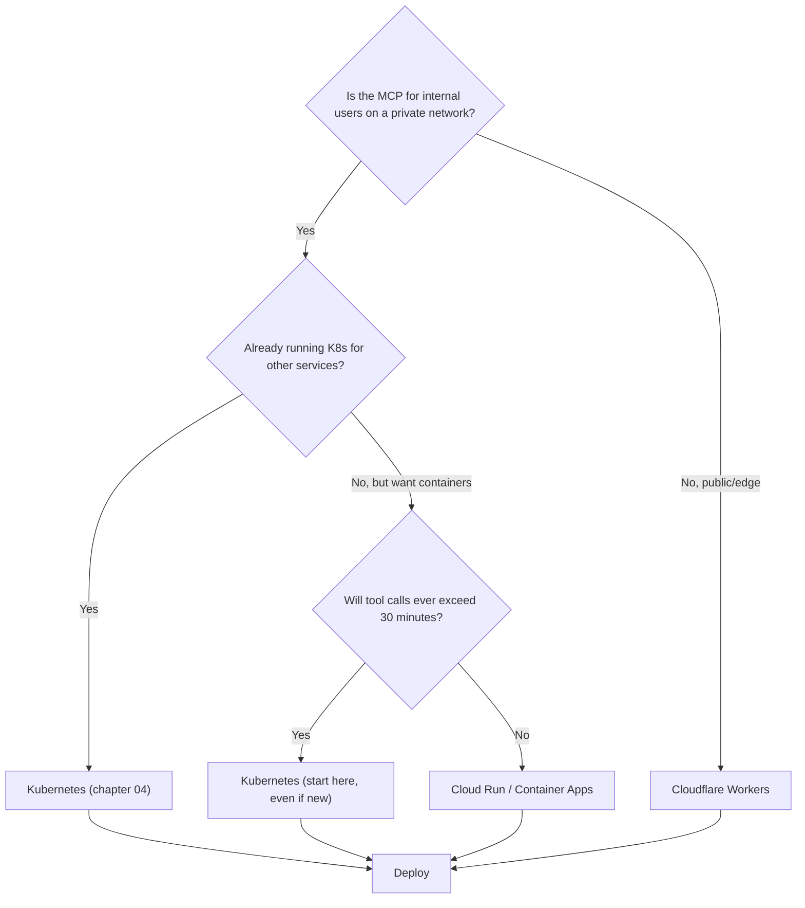

# 03. Hosting options

Streamable HTTP is, by design, an ordinary HTTP service, so almost any modern hosting platform can run an MCP. This chapter exists to give you a defensible answer to "why Kubernetes?" and to call out when you should choose something else.

> **TL;DR**: For internal multi-tenant production, choose Kubernetes. For globally distributed read-heavy public MCPs, choose Cloudflare Workers. For rapid prototyping or a single internal team's quick win, consider managed registries like Smithery, but read the security caveats before you do. [src: k8s-tmdevlab-scalable, compare-athenic-providers, compare-fastio-platforms]

## The decision matrix

| Need | K8s (recommended default) | Cloudflare Workers | Cloud Run / Container Apps | Smithery / managed registry | Vercel functions |
|---|---|---|---|---|---|
| Multi-tenant, multi-team internal hosting | Best | OK | OK | Risky (see below) | OK |
| Globally distributed, edge latency | Possible (multi-region) | Best (300+ POPs) | OK (regional) | OK | OK |
| Long-lived SSE streams (>60 s) | Yes | Yes (sub-request limits apply) | Yes | Yes | Limited (function duration) |
| Custom networking (VPC peering, on-prem) | Best | Limited | Yes | No | Limited |
| Bring-your-own auth provider | Yes | Yes | Yes | Limited | Yes |
| Time-to-first-deploy | Hours | Minutes | Minutes | Minutes | Minutes |
| Operational ownership | High | Low | Medium | Lowest | Low |
| Free tier for prototyping | Cluster-dependent | 100k req/day | Generous (CPU-second based) | 1k tool calls/month | Hobby tier |

[src: k8s-tmdevlab-scalable, k8s-skywork-helm, compare-athenic-providers, compare-fastio-platforms, cloud-mcpplayground-free, cloud-ekamoira-deploy]

## Kubernetes

**When to choose**: production-grade internal MCP servers that need centralized observability, RBAC-aware secrets, network policies, multi-team CI/CD, and predictable rolling deploys against a fleet of services.

Strengths:

- Streamable HTTP fits cleanly into the standard Service / Ingress / HPA model. There is no MCP-specific infrastructure to introduce. [src: k8s-skywork-helm, k8s-tmdevlab-scalable]
- Horizontal scaling is just an HPA away when the server is stateless. The reference chart caps at 10 replicas at 75% CPU; production deployments routinely scale further. [src: k8s-skywork-helm]
- Existing investments in service mesh, secrets backends (Vault, External Secrets Operator), policy engines (OPA, Kyverno), and observability stacks (Prometheus, OpenTelemetry, Loki) all transfer. [src: prod-systemprompt-deploy, prod-mcpcat-config]

Weaknesses / gotchas:

- Default ingress-nginx **buffers** responses, which silently breaks SSE streaming. You must set `nginx.ingress.kubernetes.io/proxy-buffering: "off"` and raise `proxy-read-timeout` / `proxy-send-timeout` (typically to `3600`). [src: k8s-tmdevlab-scalable, k8s-skywork-helm]
- HTTP/2 with keep-alive across ingress is required for predictable streaming. Mismatched HTTP versions cause SSE dropouts. [src: k8s-skywork-helm]
- Cluster cost floor is non-trivial. If a single team needs one MCP and nothing else, K8s is overkill.

The full deep dive is in [04 Kubernetes deep dive](04-kubernetes-deep-dive.md).

## Cloudflare Workers

**When to choose**: public-facing or globally distributed MCPs where edge latency matters, especially TypeScript / JavaScript codebases.

Strengths:

- Edge execution across 300+ data centers with effectively zero cold-start. [src: compare-athenic-providers]
- Generous free tier (100k requests/day) and an [official MCP server template](https://developers.cloudflare.com/agents/) lowers time-to-deploy to single-digit minutes. [src: cloud-mcpplayground-free, compare-athenic-providers]
- Built-in OAuth integrations for GitHub, Google, Slack, Auth0, WorkOS, Stytch. [src: compare-athenic-providers]

Weaknesses:

- Stateful workloads need Durable Objects or external storage; not as straightforward as a Kubernetes Deployment + Redis.
- Sub-request and CPU-time limits can affect long tool executions. Validate against your worst-case tool call before committing.
- TypeScript / JS only (Workers also supports Rust/Wasm but with more friction). Python-heavy MCPs often pick a different host.

## Google Cloud Run / Azure Container Apps

**When to choose**: you want container portability, automatic scaling, and managed TLS without operating a cluster.

Strengths:

- Run the same container image you'd run on K8s, scaled to zero between requests. [src: cloud-ekamoira-deploy]
- HTTP/2, gRPC, WebSocket, and SSE are all supported on Cloud Run. [src: cloud-ekamoira-deploy]
- Integrates with cloud-native auth (IAM identity tokens) for service-to-service traffic.

Weaknesses:

- Each request has a 60-minute hard limit on Cloud Run; long-lived SSE streams must respect this.
- Per-instance request concurrency caps (default 80 concurrent requests / instance on Cloud Run) interact awkwardly with sticky-session SSE clients. [src: cloud-ekamoira-deploy]
- Less control over network topology than K8s; VPC connectors are extra moving parts.

## Smithery and managed MCP registries

**When to choose**: you want a quick win for a common integration (GitHub, Slack, Notion) and you don't have DevOps capacity. [src: compare-athenic-providers]

Strengths:

- 5-minute setup, 50+ pre-built integrations, automatic scaling. [src: compare-athenic-providers]
- Pricing model designed around tool calls (free tier 1k calls/month). [src: compare-athenic-providers]

Weaknesses (read these before committing):

- **Security**: a June 2025 path-traversal vulnerability on Smithery exposed thousands of servers and API keys. The vendor patched it within two days, but the architectural concerns - shared multi-tenant runtime, vendor-managed secrets - are not specific to that bug and should be considered for any managed MCP registry. [src: compare-athenic-providers]
- **Vendor lock-in**: tools you publish to a registry are tied to that registry's runtime, auth model, and pricing.
- **Custom code**: most managed registries are oriented around SaaS connectors. Your bespoke internal MCP that talks to internal databases probably belongs on your own infrastructure.

For internal teams, the safest pattern is: prototype on a managed registry to validate the user experience, then migrate to Kubernetes (or Cloud Run) before going to production.

## Vercel functions / Next.js routes

**When to choose**: you already host a Next.js app on Vercel and the MCP is a thin wrapper around your existing API.

Strengths:

- Zero new infrastructure if your app is already there. [src: cloud-mcpplayground-free]
- Next.js route handlers can return SSE streams natively.

Weaknesses:

- Function duration limits apply (Vercel Hobby caps at 10 s on most plans, Pro at 60-300 s depending on configuration). Long tool calls won't fit. [src: cloud-mcpplayground-free]
- No native long-lived background workers; offload heavy work to a queue + worker on a different platform.

## Decision flowchart

## Migration paths

If you start managed and grow into K8s:

1. Containerize the MCP early (even on Cloud Run, ship a Dockerfile, not a buildpack).
2. Keep the MCP **stateless** from day one. Externalize sessions to JWT or Redis. See [05 Sessions and state](05-sessions-and-state.md).
3. Externalize secrets to a vendor-neutral store (Vault, AWS/GCP/Azure secrets manager) so the move costs nothing. [src: prod-mcpcat-config]
4. Emit OpenTelemetry traces from the start. Ingestion endpoints are swappable; instrumented code is not.

The [reference Helm chart](../examples/helm/) and [Dockerfile](../examples/docker/Dockerfile) are designed to make this migration a no-op.
