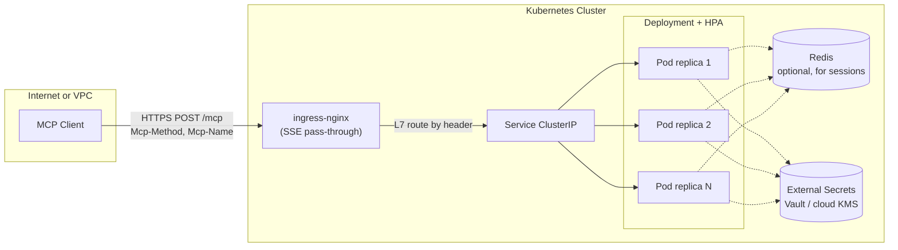
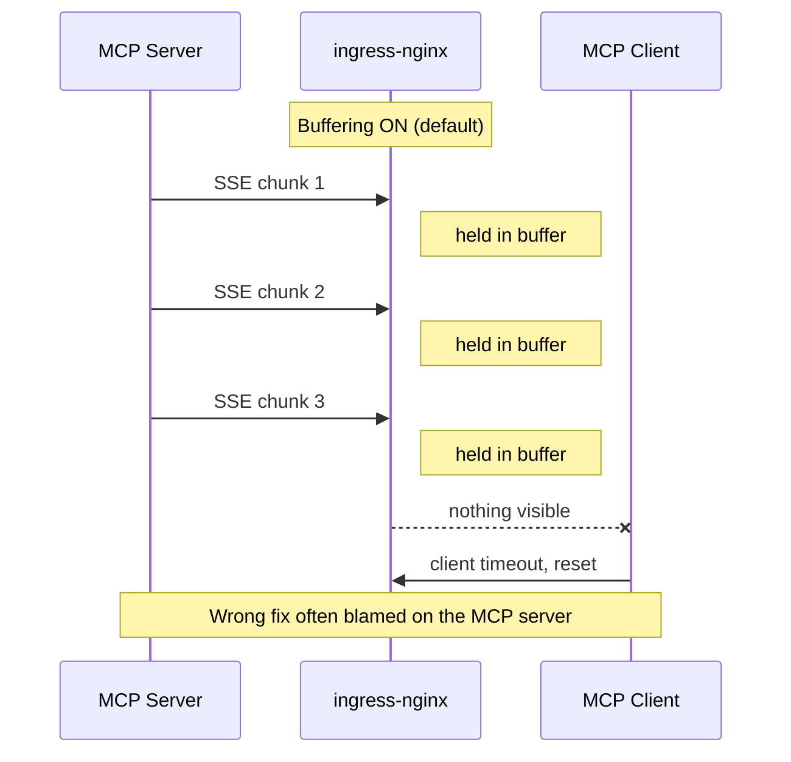

# 04. Kubernetes deep dive

This is the canonical hosting target. Read this chapter alongside [`examples/helm/`](../examples/helm/) and [`examples/k8s/`](../examples/k8s/), which contain a tested reference implementation that matches every recommendation below.

> **Prerequisites**: Kubernetes 1.27+, Helm 3.14+, an ingress controller (this chapter assumes ingress-nginx; Gateway API equivalents are noted), and `kubectl`/`helm` on the local machine. [src: k8s-skywork-helm]

## Topology



The reference deployment is intentionally boring: ingress -> service -> stateless replicas. Sessions, when needed, live in Redis; secrets live outside the cluster. [src: k8s-tmdevlab-scalable, k8s-skywork-helm, prod-mcpcat-config]

## Container image

Build a small, well-labelled, non-root image. Two patterns we recommend:

- **Multi-stage build** so the final image contains only the runtime, not build tools. [src: prod-systemprompt-deploy]
- **Distroless or Alpine** base. Smaller surface area, fewer CVEs.
- **Run as non-root** with a read-only root filesystem. Mount a writable `emptyDir` only where the runtime actually needs it.

Reference: [`examples/docker/Dockerfile`](../examples/docker/Dockerfile).

## Helm values: dev vs production

The community Helm chart family (e.g., `chatmcp/mcp-helm-chart`) ships sensible defaults; you customize via `values.yaml`. The reference values below are derived from published guides and validated against ingress-nginx 1.10. [src: k8s-skywork-helm]

### Development values (single replica, no HPA, no TLS)

```yaml
replicaCount: 1

image:
  repository: ghcr.io/your-org/your-mcp
  tag: "0.1.0"

service:
  type: ClusterIP
  port: 80
  targetPort: 8080

resources:
  requests:
    cpu: 200m
    memory: 256Mi
  limits:
    cpu: "1"
    memory: 1Gi

probes:
  liveness:
    httpGet:
      path: /healthz
      port: 8080
  readiness:
    httpGet:
      path: /readyz
      port: 8080
```

[src: k8s-skywork-helm]

### Production values (TLS, ingress, HPA, security)

```yaml
replicaCount: 3

image:
  repository: ghcr.io/your-org/your-mcp
  tag: "1.4.2"
  pullPolicy: IfNotPresent

service:
  type: ClusterIP
  port: 443
  targetPort: 8080

ingress:
  enabled: true
  className: nginx
  hosts:
    - host: mcp.example.com
      paths:
        - path: /mcp
          pathType: Prefix
  tls:
    - secretName: mcp-tls
      hosts:
        - mcp.example.com
  annotations:
    # Streaming-safe defaults
    nginx.ingress.kubernetes.io/proxy-buffering: "off"
    nginx.ingress.kubernetes.io/proxy-read-timeout: "3600"
    nginx.ingress.kubernetes.io/proxy-send-timeout: "3600"
    nginx.ingress.kubernetes.io/proxy-http-version: "1.1"
    # Defense-in-depth headers (see chapter 06)
    nginx.ingress.kubernetes.io/configuration-snippet: |
      more_set_headers "Strict-Transport-Security: max-age=31536000; includeSubDomains";
      more_set_headers "X-Content-Type-Options: nosniff";
      more_set_headers "X-Frame-Options: DENY";

resources:
  requests:
    cpu: 500m
    memory: 512Mi
  limits:
    cpu: "2"
    memory: 2Gi

probes:
  liveness:
    httpGet:
      path: /healthz
      port: 8080
    initialDelaySeconds: 10
    periodSeconds: 10
    timeoutSeconds: 2
    failureThreshold: 3
  readiness:
    httpGet:
      path: /readyz
      port: 8080
    initialDelaySeconds: 5
    periodSeconds: 5
    timeoutSeconds: 2
    failureThreshold: 3

autoscaling:
  enabled: true
  minReplicas: 2
  maxReplicas: 10
  targetCPUUtilizationPercentage: 75
```

[src: k8s-skywork-helm, k8s-tmdevlab-scalable, prod-mcpcat-config]

The `cpu` and `memory` numbers are starting points. **Right-size them with real load tests before going to production**; oversized requests waste cluster capacity, undersized requests cause OOMKill or CPU throttling that looks like client-side timeouts.

## Ingress: getting streaming right

The single most common failure mode is **silent SSE buffering**. ingress-nginx, by default, holds response chunks in a buffer to optimize batched delivery. For SSE this means clients see nothing for tens of seconds and then everything at once - or worse, the connection appears frozen and the client times out. [src: k8s-tmdevlab-scalable]



The ingress annotations that fix this:

| Annotation | Value | Why |
|---|---|---|
| `nginx.ingress.kubernetes.io/proxy-buffering` | `"off"` | Disable response buffering so SSE chunks flush in real time. [src: k8s-tmdevlab-scalable, k8s-skywork-helm] |
| `nginx.ingress.kubernetes.io/proxy-read-timeout` | `"3600"` | Keep the upstream connection open for up to an hour. [src: k8s-skywork-helm] |
| `nginx.ingress.kubernetes.io/proxy-send-timeout` | `"3600"` | Match the read timeout. [src: k8s-skywork-helm] |
| `nginx.ingress.kubernetes.io/proxy-http-version` | `"1.1"` | Required for chunked transfer encoding. [src: k8s-skywork-helm] |
| `nginx.ingress.kubernetes.io/upstream-keepalive-timeout` | `"3600"` | Avoid mid-stream upstream resets. [src: k8s-tmdevlab-scalable] |

The reference [`examples/nginx/streamable-mcp.conf`](../examples/nginx/streamable-mcp.conf) shows the equivalent nginx config block when running ingress-nginx in raw mode.

### Gateway API equivalent

If you're standardizing on Gateway API instead of ingress-nginx, the equivalent settings are:

- `BackendTrafficPolicy` with `responseTimeout: 1h` and `streaming: true` (Envoy-based gateways).
- HTTPRoute with `Retry` policy disabled for `tools/call` to avoid duplicating side effects.

## Liveness and readiness

The MCP spec does not reserve health-check paths. The convention is `/healthz` (liveness) and `/readyz` (readiness). [src: prod-mcpcat-config]

- **Liveness**: a process-internal smoke check. If it fails, kubelet kills the pod. Make it cheap and dependency-free; don't have it call your database.
- **Readiness**: includes downstream dependency checks. If your MCP needs Redis or a database, readiness fails when those are unavailable so traffic drains away from the affected pod.

Concrete pattern:

```text
GET /healthz  -> 200 if process is up; 500 if internal panic counter rising
GET /readyz   -> 200 if /healthz passes AND every external dependency is reachable
```

This keeps liveness from cascading: a Redis blip should make pods un-ready, not killed.

## Horizontal Pod Autoscaler

Start simple, escalate as needed: [src: k8s-skywork-helm, k8s-tmdevlab-scalable]

- **Phase 1**: HPA on CPU at 75% target. Captures most workloads.
- **Phase 2**: Add custom metric `requests_per_second` (via Prometheus Adapter). MCP traffic is bursty; CPU lags reality during ramp.
- **Phase 3**: Add per-pod concurrency or active-SSE-streams metric if your tools are long-running.

The autoscaler must understand that **active SSE streams should not be terminated by scale-down**. Use `terminationGracePeriodSeconds: 60` or higher and a `preStop` hook that drains in-flight streams before the pod accepts SIGTERM.

## Pod Disruption Budget

For any production MCP, set a PDB so voluntary disruptions (node upgrades, cluster autoscaler) don't take all replicas down at once. [src: prod-systemprompt-deploy]

```yaml
apiVersion: policy/v1
kind: PodDisruptionBudget
metadata:
  name: mcp
spec:
  minAvailable: 2  # or maxUnavailable: 50%
  selector:
    matchLabels:
      app.kubernetes.io/name: mcp
```

Without a PDB, the cluster-autoscaler is free to drain all pods simultaneously.

## NetworkPolicy

Restrict ingress traffic to MCP pods to only the ingress controller (and any internal callers): [src: k8s-tmdevlab-scalable]

```yaml
apiVersion: networking.k8s.io/v1
kind: NetworkPolicy
metadata:
  name: mcp-allow
spec:
  podSelector:
    matchLabels:
      app.kubernetes.io/name: mcp
  policyTypes: [Ingress, Egress]
  ingress:
    - from:
        - namespaceSelector:
            matchLabels:
              kubernetes.io/metadata.name: ingress-nginx
      ports:
        - protocol: TCP
          port: 8080
  egress:
    - to:
        - namespaceSelector:
            matchLabels:
              kubernetes.io/metadata.name: redis
      ports:
        - protocol: TCP
          port: 6379
    # DNS, secrets, OAuth issuer reachability handled separately
```

## Secrets and config

Inject secrets via Kubernetes Secrets, but **manage them outside the cluster**: [src: k8s-skywork-helm, prod-mcpcat-config]

- HashiCorp Vault + Vault Agent injector, or
- External Secrets Operator backed by AWS Secrets Manager / GCP Secret Manager / Azure Key Vault.

Plaintext secrets in `values.yaml` are an anti-pattern; commit only references.

Tool configuration (allowlists, feature flags, OAuth issuer URL) belongs in a ConfigMap mounted as files or env vars. Don't bake it into the image.

## CI/CD shape

A workable pipeline:

1. **Build**: `docker build` -> push to registry tagged with git SHA.
2. **Verify**: `helm lint`, `helm template | kubeval`, container scan (Trivy/Grype).
3. **Promote**: GitOps (ArgoCD/Flux) reconciles dev, then staging, then prod.
4. **Smoke test post-deploy**: `curl https://mcp.example.com/mcp -X POST -H 'Content-Type: application/json' -H 'Accept: application/json, text/event-stream' -d '{"jsonrpc":"2.0","id":1,"method":"initialize",...}'`. Fail the rollout if it doesn't return `200`.
5. **Rollback**: `helm rollback mcp <prev-revision>`.

## Common operational pitfalls

| Symptom | Likely cause | Fix |
|---|---|---|
| Streams "freeze" mid-response | ingress buffering | Set `proxy-buffering: "off"`. [src: k8s-tmdevlab-scalable] |
| Frequent 502s under load | Pod CPU throttling | Raise CPU limit or lower HPA target %. [src: k8s-skywork-helm] |
| Sessions intermittently 404 | Replicas don't share session state | Externalize sessions to Redis or stick to JWT. [src: k8s-tmdevlab-scalable] |
| OAuth bounce loop | OAuth callback URL doesn't match resource indicator | Verify RFC 8707 `resource` parameter matches exactly. [src: spec-authorization, sdk-mcp-oauth-blueprint] |
| `MCP-Protocol-Version` 400s | Client sending older version after upgrade | Pin client version or run a bridge per [02 Transport architecture](02-transport-architecture.md#backwards-compatibility-with-httpsse). |
| Pod restart kills active streams | Default `terminationGracePeriodSeconds: 30` too short | Raise to 60-120 s and add a `preStop` drain hook. |

## Local validation

The reference chart can be smoke-tested against `kind` with either script:

- PowerShell: [`examples/helm/smoke-test.ps1`](../examples/helm/smoke-test.ps1)
- Bash: [`examples/helm/smoke-test.sh`](../examples/helm/smoke-test.sh)

Both scripts:

1. create (or reuse) a local kind cluster,
2. install ingress-nginx,
3. deploy the chart with conservative smoke flags,
4. discover the chart-rendered Service name automatically,
5. POST a real MCP `initialize` payload to `/mcp`,
6. fail if HTTP is not `200`.

Example:

```powershell
pwsh ./examples/helm/smoke-test.ps1 `
  -ImageRepository ghcr.io/your-org/mcp-reference-server `
  -ImageTag 0.1.0
```

```bash
IMAGE_REPOSITORY=ghcr.io/your-org/mcp-reference-server \
IMAGE_TAG=0.1.0 \
examples/helm/smoke-test.sh
```

A 200 `InitializeResult` confirms the path through ingress, service, and pod is intact. CI runs the bash variant in [`.github/workflows/k8s-smoke.yml`](../.github/workflows/k8s-smoke.yml), then executes k6 thresholds from [`examples/load/k6-streamable.js`](../examples/load/k6-streamable.js).
