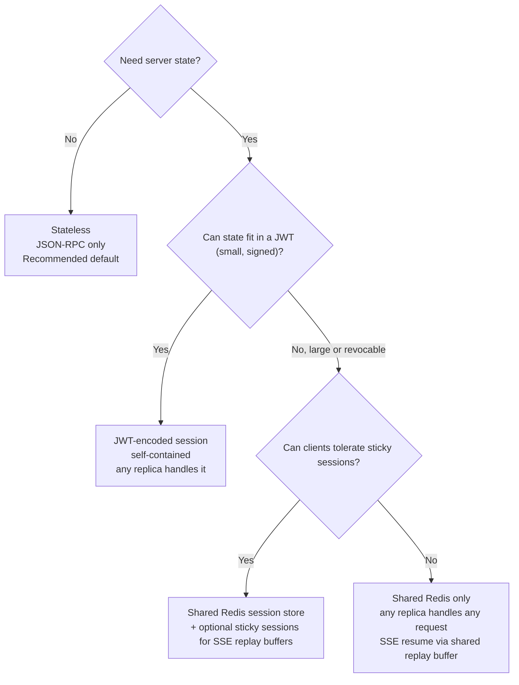
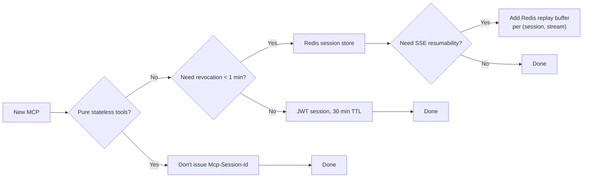

# 05. Sessions and state

The streamable HTTP transport gives the server **two valid postures**: stateless (no session at all) or stateful (session ID issued at `initialize`). Picking the right posture is the most consequential single decision for how your MCP scales. [src: spec-transports]

## The default: stateless

Unless you have a concrete reason to maintain server-side session state, **be stateless**. A stateless MCP:

- Does not return `Mcp-Session-Id` from `initialize`. [src: spec-transports]
- Treats every request as independent: any replica can handle any request.
- Scales horizontally with no coordination layer.
- Tolerates rolling deploys without dropping clients.

This is the recommended default in every production guide we surveyed. [src: prod-mcpcat-config, prod-fordel-mcp, prod-systemprompt-deploy, k8s-tmdevlab-scalable]

If your MCP only exposes pure tools (functions of their inputs), you are stateless by construction. Examples: a calculator MCP, a stateless wrapper around a REST API, a search tool. Don't add sessions you won't use.

## When you actually need state

You need server-side state when **at least one** of the following is true:

1. The client and server need a shared object that's expensive to recompute (a long-running query handle, a streaming resultset cursor, a chat thread). [src: prod-medium-streamable]
2. You're using SSE **resumability** (`Last-Event-ID`) and the buffer of replay-able events is held in memory. [src: spec-transports]
3. You authenticate per-session (e.g., a session-bound encryption key) and don't want to validate an OAuth bearer on every request. [src: spec-authorization, sdk-mcp-oauth-blueprint]
4. Tools need to subscribe to upstream events and push notifications via the GET-initiated SSE stream. [src: spec-transports]

Even in these cases, prefer to push the state out of the process (Redis, a database, a JWT) rather than holding it in pod memory.

## Three strategies, ranked



### Strategy 1: stateless (no session ID)

```text
Client                                Server
  |---- POST /mcp initialize ------->|
  |<---- 200, no Mcp-Session-Id -----|
  |---- POST /mcp tools/call ------->|   (any replica)
  |<---- 200 application/json -------|
```

Trade-offs: simplest possible operation; cannot use SSE replay; cannot avoid re-authenticating downstream calls per request.

### Strategy 2: JWT-encoded session

The server signs a JWT containing whatever it needs to recover session state (user ID, scopes, OAuth issuer, expiry) and returns it as `Mcp-Session-Id`. The client echoes it on every request. Each replica verifies the signature and proceeds. [src: prod-fordel-mcp, sdk-mcp-oauth-blueprint, k8s-paularlott-mcp]

Properties:

- Cryptographically secure with HMAC-SHA256 or a public-key signature. [src: prod-fordel-mcp]
- Horizontally scalable across replicas without coordination. [src: prod-fordel-mcp]
- No external infrastructure required. [src: prod-fordel-mcp]
- Self-expiring (the spec recommends 30-minute lifetimes for many use cases). [src: prod-fordel-mcp]

Trade-offs:

- **JWTs cannot be revoked before expiry.** If you need immediate revocation (compromised user, manual logout), pair the JWT with a short denylist in Redis or shorten the JWT TTL aggressively. [src: prod-fordel-mcp]
- Token grows with claims. Keep claims minimal; never put the OAuth refresh token inside.

This is the recommended **default for stateful MCPs** when revocation can wait minutes. [src: prod-fordel-mcp, sdk-mcp-oauth-blueprint]

### Strategy 3: shared Redis session store

The server creates an opaque session ID, persists session state in Redis under that key, and returns the ID as `Mcp-Session-Id`. Any replica can `GET <key>` from Redis to recover state. [src: k8s-tmdevlab-scalable, prod-medium-streamable]

Properties:

- Revocable: deleting the Redis key invalidates the session immediately.
- Scales with Redis throughput. With Redis Cluster or managed providers (ElastiCache, Memorystore), horizontal scale is rarely the bottleneck.
- Naturally supports SSE resumability: the per-stream replay buffer lives in Redis, indexed by session + stream, so a reconnecting client lands on any replica and replays from the buffer. [src: spec-transports, k8s-tmdevlab-scalable]

Trade-offs:

- **Operational cost**: you now own a Redis cluster. Most teams already do, which is why this option is common.
- **Read latency**: every request adds a Redis round-trip. Mitigate with Redis pipelining and a small in-process cache for read-mostly session fields. [src: k8s-tmdevlab-scalable]
- **Memory footprint**: orphaned sessions accumulate. Set TTLs and run a janitor to purge stale entries.

| Aspect | Stateless | JWT session | Redis session |
|---|---|---|---|
| External infra | None | None | Redis |
| Revocable | N/A | Hard | Easy |
| Replicas coordinate | No | No | Via Redis |
| Per-request cost | Lowest | Signature verify | Redis round-trip |
| Best for | Pure tools | Read-mostly auth | Stateful tools, SSE replay |

[src: prod-fordel-mcp, k8s-tmdevlab-scalable, prod-medium-streamable]

## Sticky sessions: avoid if possible

Sticky sessions (a.k.a. session affinity) bind a given session ID to a specific pod via the load balancer. ingress-nginx supports this via cookie-based affinity:

```yaml
nginx.ingress.kubernetes.io/affinity: "cookie"
nginx.ingress.kubernetes.io/session-cookie-name: "mcp-affinity"
nginx.ingress.kubernetes.io/session-cookie-max-age: "3600"
```

When this is reasonable: an SSE replay buffer that genuinely cannot be moved to Redis (e.g., very high-throughput, low-latency streams where the round-trip cost is unacceptable). [src: k8s-tmdevlab-scalable]

When it is **not** reasonable:

- As a substitute for designing a proper session store. Sticky sessions accumulate operational debt: rolling deploys evict every active session at once, replicas become non-fungible, and HPA scale-down picks unlucky pods.
- For long-tail tools where most calls don't need affinity. The cost is paid by every request.

If you find yourself reaching for sticky sessions, first try the JWT approach (Strategy 2). It removes the affinity requirement entirely.

## Resumability and the `Last-Event-ID` header

Resumability lets a client reconnect after a network blip and replay missed SSE events without re-issuing the original request. [src: spec-transports]

To support it: [src: spec-transports]

1. Server emits SSE events with `id:` lines.
2. Server retains a per-stream replay buffer keyed by `(session_id, stream_id)`.
3. On reconnect, client sends `GET /mcp` with `Last-Event-ID: <last-id>`.
4. Server replays events with `id > last-id` from the buffer.

Storage placement determines your scaling story:

- **In-process buffer + sticky sessions**: simplest, but breaks rolling deploys.
- **Redis-backed buffer**: any replica handles the reconnect. Trim the buffer with `XADD ... MAXLEN`.
- **No resumability advertised**: clients re-issue requests. Simplest, but tools must be idempotent or the spec's `CancelledNotification` semantics apply.

For most internal MCPs, **don't advertise resumability**. The complexity rarely earns its keep.

## Termination and DELETE

When the client knows it's done, it **SHOULD** send `DELETE /mcp` with `Mcp-Session-Id`. The server **MAY** answer `405` to indicate it doesn't allow client-driven termination. [src: spec-transports]

Operational guidance:

- Always handle `DELETE` if you maintain Redis-backed sessions; clean up the keys immediately to free memory. [src: k8s-tmdevlab-scalable]
- For JWT sessions, `DELETE` is informational; the JWT remains valid until expiry. Pair with a short-lived denylist if revocation matters.
- Always emit a session-end log line so you can correlate session lifetimes in observability tooling.

## Decision flowchart (compact)



The reference chart in [`examples/helm/`](../examples/helm/) defaults to **stateless**. To enable Redis sessions, set `redis.enabled: true` in `values.yaml` and the chart wires up a sidecar pattern with the External Secrets Operator for credentials.
