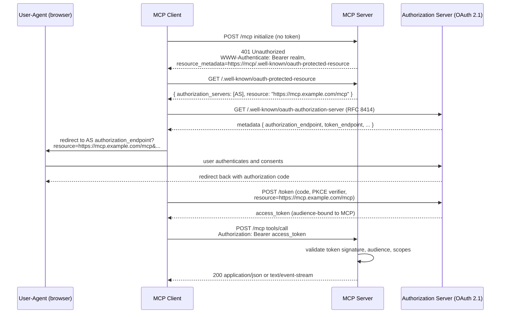

# 06. Security

A streamable HTTP MCP, like any HTTP service, is exposed to the standard catalog of web threats: token theft, request smuggling, DNS rebinding, header spoofing. The spec is opinionated about the high-impact ones; this chapter is the operational translation. [src: spec-authorization, spec-transports, spec-sep-2243]

## Threat model in one sentence

Treat the MCP server as a privileged gateway between an AI agent (which will obey crafted prompts) and your internal systems (databases, APIs, filesystems). Every layer between client and tool must verify that the request actually represents the user's intent and was actually issued by an authorized client.

## The non-negotiables

If you only do five things, do these:

1. **Terminate TLS at the ingress** with TLS 1.3 and HSTS. Plain HTTP is for `kind` only. [src: prod-mcpcat-config, prod-systemprompt-deploy]
2. **Validate the `Origin` header** on every request and bind to localhost when running locally. This defends against DNS rebinding. [src: spec-transports, prod-mcpcat-streamable]
3. **Authenticate every non-public MCP** with OAuth 2.1, including PKCE and RFC 8707 resource indicators. [src: spec-authorization, sdk-mcp-oauth-blueprint]
4. **Validate the audience** on every access token. Tokens issued for *another* MCP MUST be rejected. [src: spec-authorization]
5. **Don't pass tokens through.** When the MCP calls a downstream API, mint a new token (or use an internal service identity). Never forward the user's bearer token unchanged. [src: spec-authorization]

The rest of this chapter explains why and how.

## TLS, HSTS, and security headers

| Setting | Recommended value | Notes |
|---|---|---|
| TLS version | TLS 1.3 only (or TLS 1.2 with strong ciphers) | [src: prod-mcpcat-config] |
| Cert source | cert-manager + Let's Encrypt or internal CA | Automate rotation. |
| `Strict-Transport-Security` | `max-age=31536000; includeSubDomains` | Prevents protocol downgrade. [src: prod-mcpcat-streamable] |
| `X-Content-Type-Options` | `nosniff` | Stops MIME-type sniffing. [src: prod-mcpcat-streamable] |
| `X-Frame-Options` | `DENY` | Prevents clickjacking of any error pages. [src: prod-mcpcat-streamable] |
| `Referrer-Policy` | `no-referrer` | Don't leak query strings to outbound links. |
| `Content-Security-Policy` | `default-src 'none'` | The MCP serves JSON / SSE, not HTML. |

These are baked into the [reference Helm values](../examples/helm/values.yaml) and the [nginx config](../examples/nginx/streamable-mcp.conf).

## Origin validation and DNS rebinding

The spec's security warning is unusually direct: [src: spec-transports]

> Servers **MUST** validate the `Origin` header on all incoming connections to prevent DNS rebinding attacks.
> When running locally, servers SHOULD bind only to localhost (127.0.0.1) rather than all network interfaces (0.0.0.0).

DNS rebinding works like this: an attacker controls a domain whose DNS A record flips between an attacker IP and `127.0.0.1`. A user visits the attacker's site; their browser, now believing it's same-origin with the user's local MCP, sends authenticated requests to it. Origin validation cuts this off because the attacker domain is not in the allowlist.

Concrete operational rule: maintain a **closed allowlist** of trusted origins. Reject (`403 Forbidden`) anything else. Don't accept `*` or any wildcard origin in production.

```nginx
# From examples/nginx/streamable-mcp.conf
if ($http_origin !~* ^(https://chat\.example\.com|https://internal\.example\.com)$) {
    return 403;
}
```

The MCP server should also enforce this internally as defense in depth; the ingress check is for traffic that reaches your edge. [src: prod-mcpcat-streamable]

## OAuth 2.1: the canonical auth flow

For any MCP that exposes non-public capabilities, the spec **requires** OAuth 2.1 with PKCE and RFC 8707 resource indicators. [src: spec-authorization]



[src: spec-authorization, sdk-mcp-oauth-blueprint]

### What the MCP server must implement

Per the spec: [src: spec-authorization]

- Act as an OAuth 2.1 **resource server**.
- Publish `/.well-known/oauth-protected-resource` (RFC 9728) so clients can discover the authorization server. The metadata MUST include the canonical `resource` URI of the MCP. [src: spec-authorization]
- Require PKCE on the client side. PKCE prevents authorization-code interception attacks. [src: spec-authorization]
- Validate inbound tokens per OAuth 2.1 Section 5.2: signature, expiry, issuer, **audience**. [src: spec-authorization]
- Reject tokens whose audience claim does not include this MCP. Failing to do so is the "confused deputy" vulnerability. [src: spec-authorization]
- Never forward the user's token unchanged to downstream services ("token passthrough" is explicitly forbidden). [src: spec-authorization]

### What the MCP client must implement

- Use **RFC 8707 resource indicators** when requesting tokens. The `resource` parameter MUST be the canonical URI of the MCP server. [src: spec-authorization]
- Use PKCE on the authorization request. [src: spec-authorization]
- For public clients, the AS rotates refresh tokens. Honor the rotation. [src: spec-authorization]

The reference [`huberp/mcp-oauth-mcpserver-blueprint`](../sources/pages/sdk-mcp-oauth-blueprint.md) is a working server-side implementation; consult it when building yours. [src: sdk-mcp-oauth-blueprint]

## Token validation, in detail

A token validator inside the MCP must check, in order: [src: spec-authorization]

1. **Signature**. JWKS fetched from the authorization server. Cache with a TTL.
2. **Issuer (`iss`)**. Must match the configured issuer URL exactly.
3. **Audience (`aud`)**. Must include the MCP's canonical `resource` URI. Not "starts with", not "matches a regex". Equal.
4. **Expiry (`exp`)**. Plus a small clock-skew tolerance (60 s).
5. **Not-before (`nbf`)**, if present.
6. **Scopes**. The required scopes for the requested method/tool.

Pseudo-code:

```python
def validate(token, expected_audience, required_scopes):
    payload = jwt.decode(token, jwks=jwks(), algorithms=["RS256", "ES256"])
    if payload["iss"] != EXPECTED_ISSUER:
        raise InvalidIssuer
    aud = payload["aud"] if isinstance(payload["aud"], list) else [payload["aud"]]
    if expected_audience not in aud:
        raise AudienceMismatch
    if not required_scopes.issubset(set(payload.get("scope", "").split())):
        raise InsufficientScope
    return payload
```

Reject everything else with `401 Unauthorized` and a properly-populated `WWW-Authenticate` header so the client can re-discover the authorization server.

## SEP-2243 header spoofing

SEP-2243 introduces a class of attack that didn't exist before: a malicious or buggy intermediary can set `Mcp-Method` and `Mcp-Name` differently from the JSON body. The spec's mitigation is mandatory rejection by the server: [src: spec-sep-2243]

> Servers that process the request body **MUST** reject requests where the values specified in the headers do not match the values in the request body.

In practice, the rejection lives in your request handler, before any tool dispatch. The reference flow:

```python
def handle_post(req):
    body = json.loads(req.body)
    if req.headers["Mcp-Method"] != body["method"]:
        return 400, {"error": "Mcp-Method / body mismatch"}
    if body["method"] in ("tools/call", "resources/read", "prompts/get"):
        expected = body["params"].get("name") or body["params"].get("uri")
        if req.headers["Mcp-Name"] != expected:
            return 400, {"error": "Mcp-Name / body mismatch"}
    ...
```

Logging both header and body values on rejection helps trace where the mismatch was introduced.

## Secrets management

Don't bake secrets into images, configmaps, or `values.yaml`. The vendor-neutral options: [src: prod-mcpcat-config, k8s-skywork-helm]

| Backend | When to choose |
|---|---|
| HashiCorp Vault + Vault Agent injector | You already run Vault; you want fine-grained policy. |
| External Secrets Operator + cloud KMS | You're on EKS/GKE/AKS and want managed key storage. |
| Sealed Secrets / SOPS | You're GitOps-first and tolerant of git-hosted ciphertexts. |

What does **not** count as secrets management: env vars in plain Helm values, GitHub Actions repository secrets passed as Helm `--set`, or hand-rolled base64. None of these survive a postmortem.

## Rate limiting and abuse

Apply rate limits at two layers: [src: prod-mcpcat-config, prod-systemprompt-deploy]

- **Per-IP at the ingress**: blunt, prevents DoS from a single source.
- **Per-token (or per-user) at the MCP**: fine-grained, prevents one user from monopolizing the service.

For per-tool quotas, SEP-2243's `Mcp-Method` and `Mcp-Name` headers let you enforce them at the gateway without parsing JSON. [src: spec-sep-2243]

## Threats to specifically design for

| Threat | Mitigation |
|---|---|
| Stolen access token | Short token lifetimes (5-15 min), refresh-token rotation, audience-bound tokens. [src: spec-authorization] |
| Confused deputy / token passthrough | Mint new tokens for downstream calls; never forward. [src: spec-authorization] |
| DNS rebinding to local MCP | Origin allowlist, bind to 127.0.0.1 locally. [src: spec-transports] |
| Header / body split-brain | Reject mismatched `Mcp-Method` / `Mcp-Name`. [src: spec-sep-2243] |
| Prompt injection escalating tool privileges | Don't grant tools more authority than the user; require human-in-the-loop confirmations for destructive actions. [src: prod-mcpcat-config] |
| Shared multi-tenant runtime leak | Avoid managed registries with shared runtimes for sensitive MCPs (see [03 Hosting options](03-hosting-options.md#smithery-and-managed-mcp-registries)). [src: compare-athenic-providers] |

## Pre-deploy security checklist

- [ ] TLS 1.3 enforced at ingress; HSTS header set.
- [ ] `Origin` allowlist configured at both ingress and server.
- [ ] OAuth 2.1 issuer URL and audience configured; metadata endpoint published.
- [ ] PKCE enforced for the client integration.
- [ ] Token validation checks signature, issuer, audience, expiry, scopes.
- [ ] Tokens are not passed through to downstream services unchanged.
- [ ] `Mcp-Method` / `Mcp-Name` consistency check in the request handler.
- [ ] Secrets sourced from Vault / cloud KMS, not from Helm values.
- [ ] Rate limits configured per-IP at ingress and per-token at the server.
- [ ] Container runs as non-root with read-only root FS.
- [ ] NetworkPolicy restricts ingress to the ingress-controller namespace.
- [ ] Image scanned (Trivy/Grype) on every build.

The fuller production checklist is in [08 Deployment checklist](08-deployment-checklist.md).
