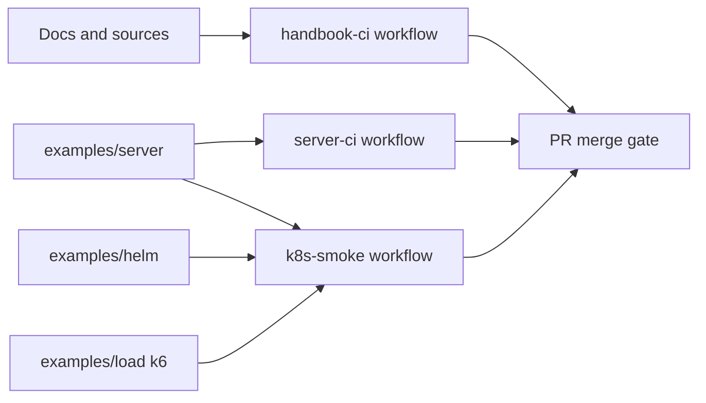

# A1. How we test this handbook

This appendix documents the executable test pipeline that keeps the handbook accurate over time.

The goal is simple: if a change breaks the documented guidance, CI should fail before merge.

## Test layers



## 1) Handbook integrity workflow

File: [`.github/workflows/handbook-ci.yml`](../.github/workflows/handbook-ci.yml)

Runs on PRs that touch docs, sources, diagrams, scripts, Helm, and markdown files.

Checks:

1. `pwsh ./scripts/validate-claims.ps1` (citation tags resolve to `sources/_index.csv`).
2. `markdownlint-cli2` with [`.markdownlint.yaml`](../.markdownlint.yaml).
3. Mermaid syntax render for every `.mmd` using `mmdc`.
4. `helm lint examples/helm`.
5. `helm template ... | kubeconform -strict -summary`.
6. Link check using lychee with [`.lycheeignore`](../.lycheeignore).

This prevents source citation drift and docs regressions.

## 2) Reference server workflow

File: [`.github/workflows/server-ci.yml`](../.github/workflows/server-ci.yml)

Runs on PRs that touch `examples/server/**`.

Checks:

1. `npm ci`
2. `npm run lint`
3. `npm run typecheck`
4. `npm run coverage`
5. `docker build -t mcp-server:ci`
6. Trivy image scan (`HIGH,CRITICAL`, fail on findings)
7. Upload coverage artifact

This keeps the executable reference implementation high-quality and secure.

## 3) Kubernetes smoke + load workflow

File: [`.github/workflows/k8s-smoke.yml`](../.github/workflows/k8s-smoke.yml)

Runs on PRs that touch Helm, server, load harness, or the workflow itself.

Checks:

1. Build server image `mcp-server:ci`.
2. Create `kind` cluster and install ingress-nginx.
3. Load image into kind.
4. Deploy Helm chart with smoke-friendly flags.
5. Run [`examples/helm/smoke-test.sh`](../examples/helm/smoke-test.sh).
6. Port-forward service and run [`examples/load/k6-streamable.js`](../examples/load/k6-streamable.js).
7. Dump cluster diagnostics on failure.

This proves the path from chart -> pod -> endpoint -> protocol behavior.

## Runtime thresholds (current defaults)

From [`examples/load/k6-streamable.js`](../examples/load/k6-streamable.js):

- `http_req_duration{scenario:tool_call_steady}: p(99) < 300ms`
- `http_req_failed: rate < 0.01`
- `stream_stall_failures: count == 0`

Adjust thresholds only with evidence from controlled load tests. If you change them, include the rationale in the PR description.

## Local parity commands

Run these before opening a PR:

```powershell
pwsh ./scripts/validate-claims.ps1
```

```bash
cd examples/server
npm ci
npm run lint
npm run typecheck
npm test
```

```bash
chmod +x examples/helm/smoke-test.sh
examples/helm/smoke-test.sh
k6 run examples/load/k6-streamable.js -e BASE_URL=http://localhost:18080
```

When local and CI outputs agree, merges are predictable and low-risk.
